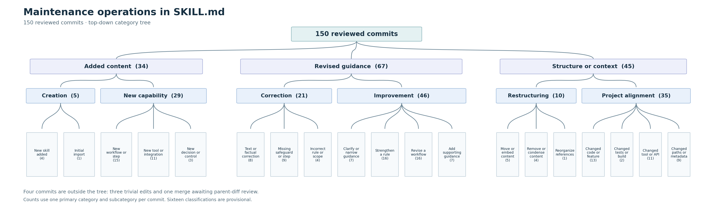

# Maintenance operations in skill files

This tree is based on a first coding pass over 150 commits from the 10-skill pilot (15 per skill). The pilot contains 339 commits. The first 17 were chosen as examples; the others were sampled from the remaining commits with a fixed random seed. The 10 skills were selected for high commit counts, so this is not a random sample of GitSkills. The image shows counts for both categories and subcategories in these 150 commits.

## Groups

- **Added content (34):** creation and new capabilities.
- **Revised guidance (67):** corrections and improvements to existing instructions.
- **Structure or context (45):** reorganizations and updates that follow project changes.

These groups organize the six main categories; each classified commit belongs to one group, category, and subcategory.

## How to classify a commit

Read the change to the `SKILL.md` file, then choose the main operation. If the only change is whitespace or another non-substantive edit, mark it "No substantive change" and exclude it from the maintenance tree. Use the commit title and keywords to find candidates, but do not let them decide the label. If the diff contains two substantial operations, record a second category. Note when the title describes changes elsewhere in the repository rather than the skill edit.

| Category | Use when the skill edit... | Example |
| --- | --- | --- |
| Creation | introduces a new skill file. | [Create `refine/SKILL.md`](https://github.com/duc01226/EasyPlatform/commit/4f8f3500349dd95c98165fda8d6fcfebc28a2d77) |
| New capability | gives the agent a new task, decision, or action. | [Resume a completed session](https://github.com/Wilder1222/superomni/commit/60ddcae41ba4a57c9fe124d3ea64ec95e9e88e87) |
| Correction | repairs incorrect text or a rule that would lead to the wrong action. | [Repair broken Unicode](https://github.com/ericpzh/AC27LevelEditor/commit/51fb67e7c195260c8d5c715ca99ee647930a1cdd) |
| Improvement | clarifies, narrows, or strengthens existing guidance. | [Clarify when to use `gabb_structure`](https://github.com/gabb-software/gabb-cli/commit/17c4aa722b4c8010202c851ce1795e4c4f72cfee) |
| Restructuring | reorganizes existing instructions or their references. | [Remove redundant protocol links](https://github.com/duc01226/EasyPlatform/commit/beba4ec75f069e73acc2bc9c16bb4d547f2cac1c) |
| Project alignment | updates the skill to match changes in code, tests, paths, or other project facts. | [Update testing instructions](https://github.com/ericpzh/AC27LevelEditor/commit/87ff028917cb546efeaa9b97ca19812bea197e57) |

## Subcategories

Each commit has one subcategory under its primary category. The `secondary_category` column separately records substantial mixed changes.

| Main category | Subcategory | Commits | Use when... |
| --- | --- | ---: | --- |
| Creation | New skill added | 4 | A skill file is added after the repository already exists. |
| Creation | Initial import | 1 | The skill appears in an initial repository import. |
| New capability | New workflow or step | 15 | The agent gets a new procedure or step. |
| New capability | New tool or integration | 11 | The agent is told to use a new tool, agent, or integration. |
| New capability | New decision or control | 3 | A new condition, fallback, or control is introduced. |
| Correction | Text or factual correction | 8 | Wrong text or a factual description is fixed. |
| Correction | Incorrect rule or scope | 4 | An existing rule is corrected or limited. |
| Correction | Missing safeguard or step | 9 | A needed guard or required step is added. |
| Improvement | Clarify or narrow guidance | 7 | Existing advice becomes more precise. |
| Improvement | Strengthen a rule | 16 | An existing requirement becomes stronger. |
| Improvement | Revise a workflow | 16 | Steps or behavior in an existing workflow change. |
| Improvement | Add supporting guidance | 7 | Explanatory or operational detail is added. |
| Restructuring | Remove or condense content | 4 | Existing material is shortened or removed. |
| Restructuring | Move or embed content | 5 | Instructions move between sections or files. |
| Restructuring | Reorganize references | 1 | References are regrouped by use. |
| Project alignment | Changed paths or metadata | 9 | Paths, configuration, or metadata are updated. |
| Project alignment | Changed tests or build | 2 | The skill follows changes in testing or building. |
| Project alignment | Changed code or feature | 13 | The skill description follows an application change. |
| Project alignment | Changed tool or API | 11 | The skill follows a tool or API change. |

Three commits have no substantive change and one merge still needs its parent diff checked. The 16 provisional classifications are included in the counts above.

The [review table](../data/gitskills/manual_category_review.csv) records the initial classifications. Some commits are mixed. For example, [inlining references](https://github.com/duc01226/EasyPlatform/commit/a907aea850a9c029ab8668cd9a712fdd693955c4) also adds workflow instructions. Calling the whole commit “refactoring” would hide that change.

The added commits use a reproducible selection method. Large mixed edits remain provisional, and one merge needs a parent-diff review. We should not report category frequencies for the full dataset from these 150 reviews.
